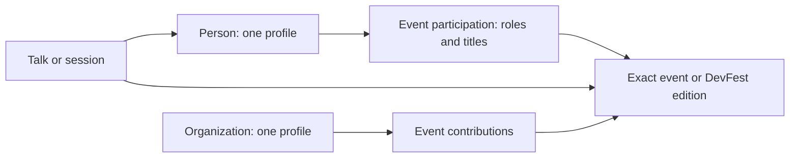
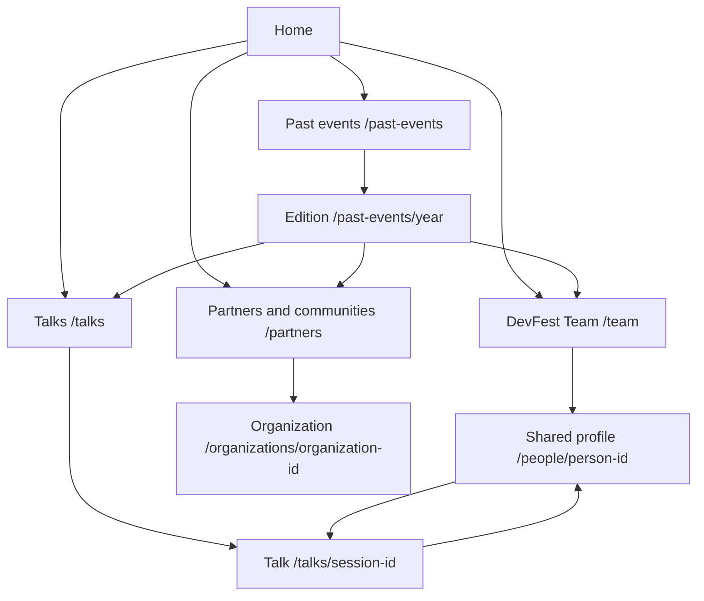

# DevFest content architecture — proposed plan

**Date:** 26 October 2026

**Status:** Foundation implemented locally on 27 October 2026. New directories remain disabled in production pending per-profile verification and organizer approval.

**Historical plan:** Its sample-ambassador and referral-invitation assumptions were superseded by the organizer’s confirmed ambassador list and subsequent retirement of the invitation pages. See `content/README.md` for the current model.
**Scope:** DevFest Team, people profiles, Talks, organizations and edition-based history. Current ticket work remains separate.

## Recommended structure

Keep each person and organization once. Store what they did at an event as a separate relationship. Build the current lists, year filters, profiles and archives from those relationships.

A person can be a core team member, volunteer, ambassador and speaker in different editions, or hold multiple roles in the same edition. An organization can contribute in different ways across editions. Neither identity should be copied into a new “past” directory.

For attendees, keep three clear destinations: **DevFest Team**, **Talks**, and **Partners & communities**. Use the organizer's requested role categories inside DevFest Team. The Core Team category distinguishes organizing responsibilities from other contributions.

## Existing content and migration gaps

Verified in the current repository:

| Area | Existing state | Change needed |
|---|---|---|
| People | 43 profiles, including one group identity | Retain stable IDs; distinguish people from group credits |
| Team | 14 memberships with roles and display groups | Add an edition/event reference and consistent role categories |
| Speakers | 29 archived edition appearances | Consolidate with edition participation; preserve speaker confirmations without a published talk |
| Sessions | 29 archived session records | Present as Talks; support multiple speakers and profile links |
| Organizations | 35 master records with nested partnerships | Retain identities; normalize edition-specific contributions and unknown-year history |
| Ambassador directory | One explicitly labelled sample profile | Sample membership is not evidence of an ambassador role |
| Referral invitations | Separate legacy records | A referral code does not establish team or ambassador participation |

Karan Mittal already has one person record and an Organizer & Operations Lead membership. His past DevFest talk titles and edition links are not yet recorded in the sessions collection. The organizer subsequently corrected the earlier speaking-history memory: those appearances were at CCD, not DevFest. CCD session records must use their own event references and verified titles.

Cloud Bytes 2025 explicitly names Karan as a speaker in its event record. This is a separate community event, not evidence of a DevFest 2025 talk. Its event title must not be turned into an invented talk title. His current ambassador directory entry is labelled as a sample and must not become a confirmed ambassador role during migration.

There are 25 historical sponsorship relationships without exact edition years, plus five ecosystem relationships. Preserve these distinctions rather than assigning years from the brand's other appearances.

## Audience and tasks

- Attendees: find this edition's team and speakers; discover talks and speaker backgrounds.
- Returning community members: find a person, talk or organization from an earlier edition.
- Organizers: update a profile once, record an edition's contributions and verify public claims.
- Prospective partners: understand current and previous contributions without confusing community participation with sponsorship.

Search, year filters and role/type filters serve these tasks. Keep Get tickets prominent in the existing header; this restructure does not need another top-level navigation bar or a content-management service.

## Data relationships



### Person

Retain `people.json` for identity: stable ID, name, default photo, public bio and public links. A current professional headline/company can be stored here as a default.

Do not treat “organizer” or “speaker” as the person's permanent identity. Event roles belong in participation records. Historical professional affiliations and photos must retain their context instead of being overwritten by a new current profile.

### Event participation

Introduce a single canonical `participations.json` collection. Replace the separate sources of team memberships, speaker appearances and real ambassador memberships after migration is complete.

One record per person per exact event contains:

- Stable ID, `personId` and `eventId`.
- A list of roles. Each has a controlled category, an event-specific display title and display order.
- Optional approved event-specific profile context, campus/community affiliation and public contact-platform choices where needed.
- Publication/reveal information and provenance where available.

Controlled DevFest Team categories:

| Stored category | Public label | Example of an event-specific title |
|---|---|---|
| `core-team` | Core Team | Organizer & Operations Lead |
| `volunteer` | Volunteers | Registration Volunteer |
| `ambassador` | Ambassadors | Campus Ambassador |
| `speaker` | Speakers | Speaker / Panelist |

These example titles describe the model; they do not add new confirmed people or assignments.

Allow several roles on one person-event record. Keep category and title separate: Core Team is the filter, while Operations Lead is the person's specific responsibility. A design or community function is a responsibility/title, not automatically a different top-level contributor category.

A confirmed speaker can exist before a talk is announced. Keep the speaker role available for this case; publishing a talk must reference a speaker participation for that same event. Neither a workshop at a campus nor an appearance at a different GDG event automatically makes someone a DevFest speaker.

### Talks

Keep `sessions.json` as the existing source initially; **Talks** is the public-facing name. Renaming the underlying file is not required to improve the site.

Each record needs its own stable ID, exact event reference, title and one or more speaker person IDs. Preserve abstracts, tracks, levels, schedule details and existing historical snapshots. Add recording, slides or resource links only when supplied. An optional format can distinguish a talk, keynote, panel or workshop when confirmed.

Extend the current single `speakerId` to `speakerIds` during a validated migration. A multi-speaker session is one talk with several linked people. Two talks by the same person are two talk records. A rerun at another edition is another occurrence with its own event reference.

Existing session-specific role/company/profile overrides must not be discarded when consolidating participation. They describe historical context, not necessarily a person's current employer or organizer title. Move a snapshot to event participation only when all appearances for that person-event agree; retain session-specific differences when they are real.

Campus workshop records remain separate in `workshops.json`. The profile can link to them, but they should not silently become DevFest event-day talks.

### Organizations and contributions

Retain each organization once in `partners.json`, including its stable ID, name, current logo and public links. Preserve an edition-specific logo/name override when an accurate historical display requires one.

Evolve the nested partnerships into one engagement per organization-event, with a list of contributions. Contribution types remain **Sponsor**, **Collaborator**, **Community** and **Media**. Each contribution can have an edition-specific role/label and source.

This supports an organization that contributes in multiple ways in the same edition, as well as one returning in later editions. Its type is a property of the contribution, not a permanent classification of the organization. Never infer sponsorship, financial tiers or amounts from a logo, community listing or collaboration.

Keep non-edition relationships explicit:

- **Edition:** exact known event reference.
- **Historical:** past contribution with an undocumented year; show it separately without inventing a year.
- **Ecosystem:** an ongoing community relationship; it does not imply event sponsorship or confirmed participation in the current edition.

Preserve current reveal flags during migration. Similar names do not prove two organizations are the same; a brand and its local chapter may be separate entities.

### Events, years and publication

Use an exact event reference, not just a year. DevFest 2025 and Cloud Bytes 2025 are different events.

Keep `event.json` as the owner of current event facts and `events.json` as the owner of existing archive/community event records. Expose a unified typed event view so every relationship and filter resolves against an actual event without duplicating dates or venues.

Year lists are derived from verified participation, talks and contributions. Do not store another manually maintained `years` list on people or organizations.

Default to the configured current DevFest edition, not the computer's calendar year. Publishing a new current edition changes which records appear as current versus past; it does not invent historical participation. The edition rollover still needs the previous event facts preserved and the new event explicitly configured.

Public confirmation/reveal state and current/archive classification are separate concerns. Older confirmed contributions should remain valid when the current edition changes. Tentative people, private contacts and negotiations stay outside public content; a hidden rendering flag is not a privacy boundary.

## Sitemap and URL plan



| Destination | Type | Behavior |
|---|---|---|
| `/team` | Listing | Current edition by default; year, role and name filters |
| `/people/[personId]` | Detail | One profile; roles by event, talks and separately labelled community/campus appearances |
| `/talks` | Listing | Talk-first discovery; published DevFest and community sessions, with exact event, year, topic/track and speaker filters |
| `/talks/[sessionId]` | Detail | Abstract, speakers, edition and available resources; retain existing session IDs |
| `/partners` | Listing | Current edition by default; year and contribution filters, plus distinct historical/ecosystem views |
| `/organizations/[organizationId]` | Detail | One organization and its documented contribution history |
| `/past-events/[year]` | Edition detail | Year-scoped links to team, talks and partners |

Use lowercase stable IDs and no trailing slash, matching current routes. Filters belong in query strings, for example `/team?year=2024&role=speaker` and `/talks?year=2025`. A person keeps the same profile URL across roles and years.

Permanently redirect `/past-speakers` to `/talks` and `/past-sponsors` to the historical sponsor view of `/partners`; migrate supported filter values and update all internal navigation, metadata, canonical URLs and sitemap entries. Do not include obsolete route names in the sitemap. Keep existing edition URLs intact.

Retain `/ambassadors` for the public contact task. It can read confirmed ambassador participation and link to `/team?role=ambassador`, while referral invitations remain a separate mechanism. Do not turn real contact profiles into duplicate people records or silently merge sample/referral records into the team.

## Navigation and presentation

Keep the current header and Explore interaction. Replace archive labels with **Talks** and the relevant partner/history destination; use **DevFest Team** for the people hub. Header ticket access, themes and practical attendee destinations retain their existing roles.

Within DevFest Team:

```text
DevFest Team
[Year: 2026 v]  [Search people...]
[Everyone] [Core Team] [Volunteers] [Ambassadors] [Speakers]

Photo  Person name → shared profile
       Event-specific title
       Relevant role badges for the selected edition
```

Within Talks:

```text
Talks
[Year: All v] [Track: All v] [Search talks or speakers...]

Talk title → talk detail
Speaker name(s) → shared profile   Exact event · Track
```

Within Partners:

```text
Partners & communities
[Year: Current edition v] [Contribution: All v]

Logo  Organization name → shared profile
      Edition-specific contribution

[Historical contributions: year undocumented] [Ecosystem]
```

Use compact rows, restrained role badges, plain links and consistent wrapping. Avoid creating another large card grid for every role. At narrow widths, filter controls and related links wrap or stack with readable spacing and usable touch targets.

One person appears once in an Everyone result, with several applicable roles. When year and role are both selected, they must match the same event participation: a current organizer with an older talk must not appear as a current speaker. Search and counts reflect the filtered records, not the person's entire history.

Talk results count talks, not speakers. Speaker names link to the same person profile used by Team. Profiles link back to specific talks and their editions. Person pages use conceptual breadcrumbs from DevFest Team; talk and organization detail pages link back to their own directories.

For the current dataset, retain straightforward local filtering and fully accessible lists. Do not add a global search service or an external database for this restructure. Detail pages should have distinct titles/descriptions and canonical URLs; filter combinations should follow a deliberate indexing policy rather than producing many duplicate indexed listings.

## Migration sequence

1. **Audit identity and evidence.** Review the 14 current team records, their exact event assignments and titles. Collect actual volunteers/ambassadors and Karan's missing DevFest talk details. Record which historical years are documented.
2. **Define schemas and relationships.** Add participation roles and event references, multi-speaker talk support and multi-contribution organization engagements. Preserve stable person, organization, session and event IDs.
3. **Migrate once.** Move authoritative team/speaker/real ambassador memberships into participation records; update typed selectors and validation; remove retired duplicate membership sources. Keep referral configuration separate. Check record counts and explain any deduplication.
4. **Build profiles and directories.** First DevFest Team and shared people profiles, then Talks, then organization/history views. Preserve current reveal states; a data migration does not announce new participation.
5. **Connect navigation and archive links.** Add redirects, preserve year context and update metadata/sitemap/internal references.
6. **Review before release.** Content validation, TypeScript, lint, formatting and production build; review mobile/desktop in both themes and the Vercel preview before any merge to production.

## Validation rules and review cases

- Every participation, speaker reference and organization engagement resolves to a known identity and exact event where applicable.
- One participation per person-event; no duplicate role category within that participation. A public session can have multiple speakers and must resolve to matching speaker participation for its event.
- One organization-event engagement can have several explicitly confirmed contribution types. Derive year lists rather than maintaining copies.
- Unknown-year history stays out of precise year filters. Ecosystem relationships never appear as current sponsors merely because they share an identity.
- Historical biographies and affiliations remain intact when a current profile changes.
- A person with several roles appears once in Everyone, in each appropriate role filter and only for the correct event/year combination.
- Verify the Karan case without inventing talk details: one profile; the organizer role linked to its confirmed edition; older DevFest appearances added when exact details are supplied; Cloud Bytes remains separately labelled; the sample ambassador record is not a confirmed role.
- Verify a two-speaker talk, two talks by one person, a returning organization, simultaneous organization contributions and an unknown-year sponsor.
- Verify legacy redirects and filters, empty states, keyboard navigation, readable focus states, mobile wrapping and revealed/unrevealed content.

## Outstanding evidence and label validation

This proposal uses the organizer's requested categories and the repository's existing records. No attendee interviews, card sorting or tree testing have been performed. Treat the labels and discovery flows as a proposed structure, then test whether an attendee can find a current speaker, an old talk and an earlier partner contribution.

Exact historical team assignments, additional volunteer/ambassador memberships, missing DevFest talk titles/years and undocumented sponsorship years still require source data. The model supports them; the plan does not fill those gaps with assumptions.

## Organizer correction — 27 October 2026

Karan’s historical speaking example is CCD, not DevFest. The verified CCD 2025 workshop is stored under its own event. Talks therefore supports an exact-event filter in addition to year and track, and labels each result with its event name. The DevFest Team speaker filter continues to require participation in that exact DevFest edition. CCD 2024 session details remain outside public records until verified.
