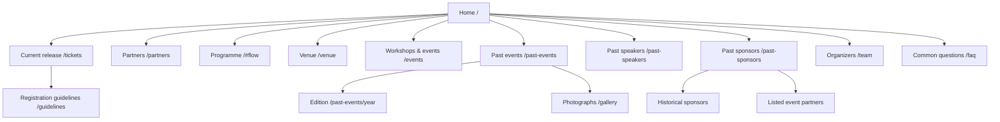

# Information architecture: DevFest Indore 2026

Updated 23 October 2026 · implemented local revision · validation with attendees still pending.

## Audience and tasks

Developers need to understand technical relevance, choose the current pass and find the venue. Students also look for workshops and community events. Prospective partners and speakers want to assess previous editions, contributors and organizational history. These tasks are organized by event time and purpose, rather than internal campus or sponsorship management categories.

Get tickets is the primary homepage action and is always visible in the sticky header, including on mobile. Programme remains a secondary action. Tickets are also reachable through Explore and the footer. Archive indexes, workshops and questions are available from Explore; full directories also appear in the footer. No user interviews, card sorting or tree tests were available for this revision, so these labels follow the organizer’s explicit wording and should be tested with attendees.

## Sitemap



## Navigation wireframes

```
Desktop / mobile header
[GDG · DevFest Indore] [Social icons] [Programme] [Sun | Moon] [Explore v] [Get tickets]

Explore disclosure
[Attend / tickets & pass details]            [Discover]
[Registration guidelines]                   [Partners & collaborators]
[Archive]                            [What’s on]
  Past events                        [Getting here]
  Past speakers                      [Workshops & events]
  Past sponsors                      [Common questions]
  Photo gallery
```

On mobile the disclosure stacks its groups and scrolls inside the available viewport. Ordinary navigation links retain browser behavior. Escape closes the disclosure and returns focus. Clicking outside, following a link or leaving header focus also closes it.

Footer groups: Attend (tickets, programme, venue, questions and ticket policies); Get involved (CFP, collaborators, partner application form, team and code of conduct); Community (Instagram, LinkedIn, GDG chapter, YouTube, GitHub and X); Explore more (workshops & events, gallery and archive indexes). Appearance choices remain in the header. Instagram, LinkedIn and X appear as labelled icon links in the header; on narrow screens they use a second row. The footer combines five social icon links with the GDG chapter link. Tickets use a single navigation entry, so simultaneous pass releases do not create several menu items with the same destination. Current release information remains on `/tickets`.

## Routes and responsibilities

| URL | Type | Content |
|---|---|---|
| `/` | Landing | Five chapters; primary ticket action; secondary programme link |
| `/tickets` | Current listing | Only current/next release according to time |
| `/tickets/[former-pass-id]` | Permanent redirect | All former ticket subpages lead to `/tickets`; query values are preserved |
| `/guidelines` | Practical guide | Profile preparation, all approved policies with explicit pass scope, conduct and support |
| `/partners` | Current edition | Contribution options and official partner application; confirmed collaborator cards when revealed |
| `/venue` | Arrival guide | Verified venue photo, address, directions, embedded map and check-in requirements |
| `/events` | Directory | Sourced community events, searchable workshop records |
| `/workshops` | Permanent redirect | `/events#workshops` |
| `/past-events` | Index | Verified 2022–2025 DevFest editions |
| `/past-events/[year]` | Detail | Official record, date, venue, documented people and partners |
| `/past-speakers` | Directory | One person, grouped appearances; edition/track/search |
| `/past-sponsors` | Directory | Sponsors and listed partners as separate views |
| `/gallery` | Archive | Real photographs with honest edition captions |
| `/team` | Directory | Compact organizer profiles |
| `/faq` | Support | Event questions plus confirmed ticket policies |

The public site has no admin or telemetry route. Organizers update checked-in content through Git; Sessionize owns CFP submissions, and KonfHub owns ticket registration. Archive navigation connects its indexes; each edition detail links back to its index. Sources are outbound links, not internal detail pages with duplicated external descriptions.

## Content model and taxonomy

- **Edition:** year, date, display date, venue, summary, official source, listed partner names, publicly named speaker subset. A source’s RSVPs are never interpreted as attendance.
- **Speaker appearance:** person identity, edition, affiliation at the edition, topic, track, biography, portrait, profile links. Normalize names for display grouping; retain individual appearances.
- **Organization:** name, relationship, edition set, source records. A partner listing does not imply paid sponsorship. The supplied sponsor sheet has `Earlier editions` where dates are absent.
- **Published partner:** checked-in record plus explicit `edition`. Confirmed 2026 records feed the current rail; 2022–2025 feed the archive; unassigned entries do not imply current involvement.
- **Workshop:** existing organizer record, institution, topic, speaker, community/photo links. No inferred dates.
- **Community event:** title, date, format, venue, official source. Keep historical labels explicit.

Controlled labels: What’s on; Getting here; Workshops & events; Common questions; Past events; Past speakers; Past sponsors; Photographs. Use these consistently in navigation. Avoid Campus workshops as the top-level destination because the section includes more than campuses.

## Growth rules

The homepage has fixed-size previews rather than a card per record. Keep two partner logos visible, twelve initial organization rows, twelve speaker results per page and six initial workshop rows. Adding data grows the directories and carousel sequence. It does not grow the homepage. Source new historical claims, deduplicate organizations and people, and avoid assigning years, sponsor tiers or attendance without evidence.

“Programme” is the public navigation label across the header, Explore, hero, section, footer and page rail. The existing `#flow` anchor and internal content names remain stable. The old `#tickets` fragment now lands on the footer’s Attend navigation, which retains the ticket page and policy links. Individual session times and speakers remain explicitly coming soon.

The homepage and footer partner actions use `event.links.partnerApplication`. The referral notification is informational text with a close icon and no action links. Dismissal lasts for the browser session and does not clear the saved referral code. It displays only when a referral code is stored.

The ticket listing shows eligibility before registration, followed by inclusions on narrow screens. The LinkedIn reminder sits immediately before Register. The separate booking steps and repeated policy disclosures have been removed; Guidelines owns the complete rules. The prominent red Register action opens the public KonfHub event when the registration switch is enabled. KonfHub owns live availability and prices; local release windows choose the pass preview independently of that outbound action.

Registration guidelines are reconciled in canonical ticket JSON. General entry, accuracy, capacity and correction rules apply across releases; pass-scoped rules use stable policy IDs and optional `appliesTo` fields. A short KonfHub profile/LinkedIn reminder is visible beside Register; the full profile guidance lives on Guidelines. The matching KonfHub copy is an export for review, not a second source of application content.

## Practical launch pages — 22 October 2026

Guidelines, Partners and Venue are implemented locally. Their title/lead/support copy and guideline policy placement live in `content/pages.json`. Policy text, organization identity and venue facts remain in their existing canonical files. Validation enforces complete, non-duplicated guideline coverage. The new pages have canonical/social metadata and sitemap entries.

Guidelines uses an in-page contents list, sticky beside the text on desktop and stacked above it on mobile. Direct section links cover before-booking, entry, eligibility, workshops, ticket-policy and support. Tickets and pass pages link to it; `/tickets#attendee-policies` still works. Explore and the footer link to Guidelines, Partners and Venue, and the homepage partner/venue previews link to their full pages. Get tickets remains visible in the header. Programme remains `/#flow` until confirmed sessions warrant a full page.

The partner page focuses on contribution options and the official application form, adding the confirmed collaborator cards when revealed. The venue page combines its introduction with the real photo/address, then pairs the map with check-in information and a link to full guidelines. Parking, accessibility facilities, room plans and city activities are not inferred from dormant source components.

## Homepage refinement — organizer direction, 22 October

The flight navigation now runs horizontally immediately below the sticky header. It uses the same page-specific anchors, preserves 44px mobile targets and follows header/banner height changes. Removing the sidebar restores the ordinary content gutters. Progress reverses with scrolling and the planet returns to the document top. Reduced motion keeps the anchor links and hides the moving craft.

Hero date/location and Programme action are larger. Programme has a compact heading, a two-word tagline and the agenda status below the topic selector. Homepage sections grow from their content instead of imposing a shared 680px minimum.

Partner announcements are temporarily held behind `pages.partners.revealed=false`. Both public partner surfaces show a reveal-soon invitation and central application button. The existing confirmed card design remains available when the switch is enabled. Ecosystem logo cards use three desktop/two mobile columns, followed by a compact historical community/network wall with edition years. Historical relationships do not imply current partnership.

The community chapter acknowledges the organizer-confirmed 2014 origin, links the available 2022–2025 editions along a line, and displays a manual photo carousel. Past events, speakers and sponsors sit below it. Photos include DevFest and other GDG Cloud Indore events, distinguished in captions. The full gallery uses matching broader community wording. Venue uses a larger photo, closer columns and grouped direction/arrival buttons. See `photo-selection-2026-10-22.md` for provenance.

## Content and space refinement — 23 October 2026

Implemented the approved culling plan in `content-culling-plan-2026-10-22.md`. Home no longer repeats Programme topics in the hero or repeats the history origin in three places. Programme retains its selector, illustration and concrete tags without the additional text flow. The partner teaser has one headline; the enlarged ecosystem grid and historical labels stay on Home. Venue presents the date once, with a single directions action and compact arrival details beside the map. FAQ uses explicit content groups, contextual detail links and simple disclosure rows instead of another pass catalogue. The header ticket action, rocket navigation, community photographs and full Guidelines policies remain. No routes were removed.
