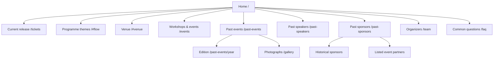

# Information architecture: DevFest Indore 2026

20 October 2026 · implemented local revision · validation with attendees still pending.

## Audience and tasks

Developers need to understand technical relevance, choose the current pass and find the venue. Students also look for workshops and community events. Prospective partners and speakers want to assess previous editions, contributors and organizational history. These tasks are organized by event time and purpose, rather than internal campus or sponsorship management categories.

The main purchase action remains one click from home. Archive indexes, workshops and questions are available from Explore; full directories also appear in the footer. No user interviews, card sorting or tree tests were available for this revision, so these labels follow the organizer’s explicit wording and should be tested with attendees.

## Sitemap



## Navigation wireframes

```
Desktop / mobile header
[GDG · DevFest Indore]                 [Sun | Moon] [Explore v]

Explore disclosure
[Attend / current release]            [Discover]
[Archive]                            [What’s on]
  Past events                        [Getting here]
  Past speakers                      [Workshops & events]
  Past sponsors                      [Common questions]
```

On mobile the disclosure stacks its groups and scrolls inside the available viewport. Ordinary navigation links retain browser behavior. Escape closes the disclosure and returns focus. Clicking outside, following a link or leaving header focus also closes it.

Footer groups: Attend; Community (organizers, archive indexes, photographs, workshops & events); Get involved (CFP, partnership enquiry, official community channels). Appearance choices repeat in the footer.

## Routes and responsibilities

| URL | Type | Content |
|---|---|---|
| `/` | Landing | Six compact chapters; one current pass action |
| `/tickets` | Current listing | Only current/next release according to time |
| `/tickets/[existing-pass-id]` | Detail | Existing links preserved; future passes guarded |
| `/events` | Directory | Sourced community events, searchable workshop records |
| `/workshops` | Permanent redirect | `/events#workshops` |
| `/past-events` | Index | Verified 2022–2025 DevFest editions |
| `/past-events/[year]` | Detail | Official record, date, venue, documented people and partners |
| `/past-speakers` | Directory | One person, grouped appearances; edition/track/search |
| `/past-sponsors` | Directory | Sponsors and listed partners as separate views |
| `/gallery` | Archive | Real photographs with honest edition captions |
| `/team` | Directory | Compact organizer profiles |
| `/faq` | Support | Event questions plus confirmed ticket policies |

The public site has no admin or telemetry route. Organizers update checked-in content through Git; Sessionize owns CFP submissions, and KonfHub owns ticket registration. Archive navigation connects its indexes; each edition detail links back to its index. Sources are outbound links, not internal detail pages with duplicated external descriptions.

## Content model and taxonomy

- **Edition:** year, date, display date, venue, summary, official source, listed partner names, publicly named speaker subset. A source’s RSVPs are never interpreted as attendance.
- **Speaker appearance:** person identity, edition, affiliation at the edition, topic, track, biography, portrait, profile links. Normalize names for display grouping; retain individual appearances.
- **Organization:** name, relationship, edition set, source records. A partner listing does not imply paid sponsorship. The supplied sponsor sheet has `Earlier editions` where dates are absent.
- **Published partner:** checked-in record plus explicit `edition`. Confirmed 2026 records feed the current rail; 2022–2025 feed the archive; unassigned entries do not imply current involvement.
- **Workshop:** existing organizer record, institution, topic, speaker, community/photo links. No inferred dates.
- **Community event:** title, date, format, venue, official source. Keep historical labels explicit.

Controlled labels: What’s on; Getting here; Workshops & events; Common questions; Past events; Past speakers; Past sponsors; Photographs. Use these consistently in navigation. Avoid Campus workshops as the top-level destination because the section includes more than campuses.

## Growth rules

The homepage has fixed-size previews rather than a card per record. Keep two partner logos visible, twelve initial organization rows, twelve speaker results per page and six initial workshop rows. Adding data grows the directories and carousel sequence. It does not grow the homepage. Source new historical claims, deduplicate organizations and people, and avoid assigning years, sponsor tiers or attendance without evidence.
