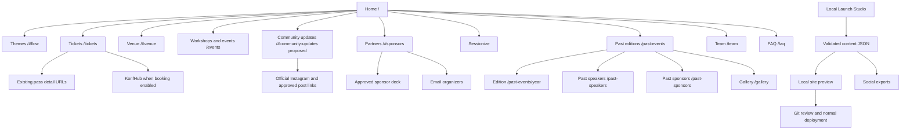

# DevFest Indore launch plan

22 October 2026 · proposed implementation · no deployment or application changes made by this plan.

## Recommendation

Keep the public site powered by the validated JSON records already in `content/`. Add a local **Launch Studio** that gives organizers the useful editing experience of the former admin panel, saves those same files, previews the site, and produces social graphics. Continue using Sessionize for submissions and KonfHub for registration. Firebase is unnecessary for this scope.

The local editor is a publishing tool. It cannot receive submissions from public visitors while the organizer's computer is offline, synchronize several editors automatically, or measure all website visitors by reading its own browser storage.

## What was checked

- Current application, content schemas, validation script, navigation, footer, homepage and project documentation.
- Earlier admin and telemetry source in Git revision `8154151`. That admin covered workshops, navigation, gallery, partners, FAQs, team, speakers and agenda; telemetry used Firestore and local browser fallbacks.
- Rendered homepage and homepage link destinations at https://devfest.indore.community/ on 22 October. The web extraction service could not access it; direct browser inspection succeeded.
- Rendered homepage at https://devfest2026-iota.vercel.app/. Both public URLs showed the older long-form experience. Neither rendered homepage matched the local six-section redesign. Hosting ownership and deployment configuration remain unverified.
- No private dashboards, Google Drive deck contents, checkout configuration, analytics account or Sessionize submission state were accessed. Finding a public link establishes its presence, not the validity of its contents or account setup.

## Comparison and decisions

| Area | Original public homepage | Current workspace | Launch decision |
|---|---|---|---|
| Content management | Earlier source includes Firebase-backed admin and browser fallbacks | Admin removed; schema-validated JSON with stable IDs | Restore editing convenience over JSON |
| First visit | Intro loader, many sections, repeated statistics and themed labels | Six sections, date and venue, ordinary ticket action | Keep compact attendee journey |
| Event claims | 1,500+ headline audience, 600+ elsewhere, 800+ in footer; broad ticket benefits | Approved event/pass records; booking disabled | Use current records; omit unresolved totals |
| Speakers | Large alumni strip and CFP section | Historical directory; no confirmed 2026 speakers | Label alumni by edition; publish current speakers only when confirmed |
| Instagram | Elfsight-labelled live-feed section and profile link | Instagram URL exists in event JSON but shared footer exposes only LinkedIn | Add curated previews and a visible Instagram link |
| Community | X, LinkedIn, Instagram, YouTube, GitHub and GDG chapter | Some links retained as data; several absent from navigation | Restore useful official destinations in grouped footer |
| Partners | Sponsor enquiry plus Drive deck; past/current organizations mixed | Confirmed current partners separated from archive; enquiry present | Retain separation; restore deck after verifying approved version |
| Programme | “View Schedule” links to `#sessions-split` | Themes explicitly say agenda and speakers are coming soon | Add programme only when confirmed; never relabel themes as a schedule |
| Venue | Postal code 452018 | Approved record uses 452016 | Keep canonical record; do not copy old address |
| Launch location | Public original domain and Vercel preview show older experience | The event record used a different canonical URL at the time of this review | The organizer confirmed `devfest.indore.community` as the official domain on 27 October; verify redirects and deployment source before publishing |

The recovery inventory is in `launch-link-audit-2026-10-22.csv`. It covers homepage navigation and principal outbound journeys, not a complete crawl of every historical profile and workshop page.

## Audience and journeys

| Visitor | Journey | Success condition |
|---|---|---|
| Attendee from Instagram | Campaign link → relevant site section or tickets → pass eligibility/inclusions → KonfHub when enabled | Knows date, venue, applicable pass and next action without searching |
| Speaker | “Speak at DevFest” → Sessionize | One proposal system; no duplicate local submission form |
| Partner | Current collaborators → approved sponsor deck → organizer email | Finds contribution context and a clear contact route |
| Student | Workshops & events → actual campus recap → original post/photo album | Understands whether an item is historical or upcoming |
| Returning attendee | Past editions → edition detail → people and gallery | Past participation cannot be mistaken for a 2026 announcement |
| Organizer | Launch Studio → edit → validate → local preview → review changes → normal deployment | Content is saved durably and publishing is a separate, explicit action |

## Proposed navigation and sitemap

Keep one prominent ticket action, the current Explore disclosure, and a compact footer. Avoid a top-level tab per audience or database table.



Proposed desktop header:

```text
[GDG Indore / home]             [Themes] [Appearance] [Explore] [Tickets]
Explore: Attend | Discover | Get involved | Archive
```

On mobile, keep the brand, Explore and appearance control; ensure ticket access is visible in the first screen and inside Explore. Stack groups in the disclosure, retain Escape/outside-click behavior, and ensure it fits short screens.

Proposed footer:

```text
Attend                  Get involved                 Community
Tickets / pass policies Speak at DevFest             Instagram / LinkedIn
Venue / directions      Partner / sponsor deck       GDG chapter / YouTube
FAQ / contact           Team / code of conduct       Past editions / gallery
                                                     Workshops & events
```

X and GitHub can be secondary social links once ownership/current relevance is checked. They need not compete with Instagram. Keep `/workshops` redirecting to `/events#workshops`; preserve existing pass and invitation URLs. Add aliases for verified legacy section fragments where their meaning still matches: `#about`, `#pillars`, `#call-for-speakers`, `#social-stream`, `#satellite-events`. URL fragments are not sent to the server, so fragment recovery needs matching elements or explicit client-side handling, rather than server redirect rules. Never send an old “schedule” link to unrelated content and imply it is an agenda.

## Local Launch Studio

Suggested sections: Overview; Website copy; People & speakers; Sessions; Partners; Workshops & gallery; Tickets & event; Social exports; Links & launch checks.

```text
Launch Studio                          [Open site preview]
Overview          Event facts          Saved locally / unpublished changes
Website copy      Date / venue         [Preview changes]
People            Selected record      [Validate and save]
Sessions          Form fields          [Review file changes]
Partners          Publication status
Social exports    Platform / template  [Download graphic] [Copy caption]
Links & checks    Destination / status [Open destination]
```

Implementation contract:

1. Use a separate local companion entry point, with a proposed `npm run studio` command; the command does not exist yet. Bind to `127.0.0.1`. Keep its file-writing server outside the public Next.js deployment. Share the site's visual tokens and content validation logic.
2. Forms read and write allowlisted `content/*.json` records; image import writes only supported image files under a controlled public asset directory. Reject arbitrary paths, traversal and symlinks that escape approved directories. Check request origin and use a session write token; localhost alone is not request authorization.
3. Validate the proposed full dataset before saving so IDs, references, publication rules and local image paths remain consistent. Save via temporary files and atomic replacement; detect stale edits. Coordinate multi-file changes such as adding a person and a speaker appearance with a recoverable transaction/backup, rather than leaving half the operation saved.
4. Show “Saved locally” and “Not published” separately. Provide a preview and readable change summary. Git history supplies review and rollback; saving must not push or deploy automatically.
5. Put draft announcements, private applications, exports containing private operational data and credentials outside public content and outside tracked public assets. Public JSON contains approved facts only. Do not invent a public `draft` publication value unsupported by the current schemas.
6. Add schema-backed public copy fields for currently hardcoded hero, section, CTA and footer wording. A proposed `content/site.json` can own this copy; avoid a second competing event date, venue, person or ticket record. Navigation can have a small validated model if editability is useful, while homepage composition remains controlled.
7. Use existing local images first. Cloudinary URLs can remain delivery sources for existing images; optional upload support is a later explicit online action. No image-hosting credential belongs in browser code.

Public site content needs a new deployment after edits. Vercel Functions have a read-only filesystem with temporary scratch space, so production file writes are not a durable content database: https://vercel.com/docs/functions/runtimes#file-system-support.

Local operations versus online services:

| Capability | First version |
|---|---|
| Edit website copy, people, partners and tickets | Local forms → validated JSON → review → deploy |
| Preview and social image generation | Local; works without an online CMS |
| Ticket sales and eligibility enforcement | KonfHub; website launch gate remains authoritative for displaying checkout |
| Proposals and review workflow | Sessionize; shortcut from Studio |
| Website traffic | Existing GA4/GTM reports; shortcut from Studio, no fabricated local totals |
| Geographic breakdown / ticket revenue inside Studio | Later verified report import or authenticated read integration, labelled with source and refresh time |
| Several organizers editing simultaneously from phones | Would require a shared service or explicit Git workflow; outside local-only first version |

## Instagram and campaign visuals

Treat two needs separately: **create campaign assets** and **show real community activity on the website**. Neither requires an always-running Instagram feed widget.

Use the current approved identity in `design-system.md`: Google Sans, DevFest/इंदौर lockup, four-color signals, rounded artwork windows and the supplied Android astronaut. Use actual portraits, organization logos and verified event photographs. Keep dates, names, URLs and small print as editable text in templates. Existing artwork is sufficient for the first set; generate new illustration only for a specific missing need.

Proposed export presets (our chosen production sizes, not a claim about every platform upload limit):

| Template | Presets | Source and release condition |
|---|---|---|
| Save the date | 1080×1350 feed; 1080×1920 story | Event name, date and venue from event JSON |
| Ticket release | Feed + story | Current pass record; price only when approved; booking CTA only when enabled |
| CFP | Feed + story | Sessionize destination; verify submissions are actually open before “Apply now” |
| Speaker / session announcement | Feed + story | Confirmed 2026 person, appearance and approved session |
| Partner announcement | Feed + story | Confirmed edition-specific contribution and approved logo |
| Workshop / community recap | Feed + story | Verified photos, accurate institution/edition and real original post URL |
| “I'm attending” card | Square 1080×1080 + story | Optional local name/photo; no claim that the person is registered or verified |
| Link preview | 1200×630 | Same event facts; readable at small size |

A local renderer can output PNG plus caption text, alt text and a campaign link from one selected record. Reflow layouts for each ratio; do not simply crop text-heavy feed cards into stories. Check long names/titles, approved logo spacing and mobile legibility. Keep primary text clear of story controls and preview real exports before use.

Use one named action per asset: date announcement → event overview; ticket release → `/tickets`; CFP → Sessionize; partner enquiry → partners section/email. Build UTM-tagged site links with stable campaign names, preserve existing referral codes, and keep canonical URLs free of campaign parameters. A local editor can generate these assets; automatic Instagram publishing is a separate online integration and is not required for launch.

Website showcase: a compact, manually curated group of up to three approved post/reel previews with local thumbnail assets, accurate captions and original permalinks, plus “Follow @gdgindore”. Keep the fuller collection under events/gallery if needed. No autoplay or third-party script on initial load. If an embed is desired later, load it on request and retain a plain-link fallback. Use actual local supplied media; do not treat a profile URL as a specific post or imply it is a live feed. Add a `content/social.json` model and schema only during implementation; do not store a duplicate speaker/partner identity there.

## Copy pass

Keep the warmth of the orbital theme while making labels describe their destinations. Review each page by the visitor's next decision.

| Surface | Copy direction |
|---|---|
| Hero | Name, date, venue and what attendees can explore; one primary ticket action |
| Themes | Explain the subject and practical relevance; distinguish themes from announced sessions |
| Tickets | Current release, eligibility, inclusions/exclusions, actual price/fees when supplied, final policies, launch state |
| Speakers | Explicit current/historical edition; no inferred current affiliation or confirmation |
| Partners | Real contribution, current edition, approved description, clear enquiry route |
| Events | Historical/upcoming state, known date, actual registration/post/album link |
| Venue | Approved address, check-in time, directions; only confirmed accessibility/travel information |
| Footer | Discoverable contact, CFP, community channels, policy and code-of-conduct links |

Starter wording for review:

- Hero lead: “Space technology. AI agents. Systems we build together.”
- Hero body: “Join GDG Indore for a day of technical talks, hands-on learning and conversations with the developer community.” Date and venue should be rendered from event data next to this copy.
- Community preview: “From the Indore developer community.” Supporting text: “Workshop moments, community stories and the road to DevFest.” Action: “Follow @gdgindore”.
- Partnership action: “Partner with DevFest”; supporting action “View the sponsor deck” only after the deck is verified.
- CFP action: “Submit a talk on Sessionize”; only advertise an open submission window after checking it.
- Closed checkout: “Booking is not open yet.” Show an opening time only if the launch status and recorded release window support that promise. Do not imply a waitlist exists.

Do not copy original promises of cash bounties, certificates, cloud credits, VIP dinners, universal workshop/food access, or attendee/speaker totals into the new site without current confirmation.

## Delivery order and acceptance

1. **Recover links and complete the copy inventory.** Restore Instagram/chapter/gallery/event discoverability, verify the sponsor deck and code-of-conduct destination, map old URLs/fragments, and reconcile stale documentation with code. Acceptance: each primary journey has a clear next action, every recovered link has a recorded destination, and header/footer work on mobile and keyboard.
2. **Build the local Studio foundation.** Start with event/links, FAQs, people/partners and the copy surfaces needed for launch, then sessions/gallery/workshops. Acceptance: a valid edit updates the real JSON and preview; invalid and stale edits are rejected; changes survive restart; there is no public write endpoint. Run content validation and TypeScript checks for model changes.
3. **Produce the first social pack.** Date announcement, current ticket-release draft, CFP draft, partner template and link-preview card. Acceptance: PNGs at requested sizes, readable long-text examples, captions and alt text; website and cards use the same facts. Publication-dependent templates remain drafts until their release conditions are verified.
4. **Showcase community activity.** Add curated original posts and approved media; recover event/album links. Acceptance: no empty widget, invented post URL or mislabeled photo; no unnecessary third-party load on initial page view.
5. **Prepare launch deployment.** Verify target repository/branch, final domain and redirects; test actual checkout setup and analytics configuration; confirm social previews and event schema use the final canonical URL. Acceptance: deployment preview matches the reviewed workspace, booking remains disabled until verified, appropriate checks pass, and the deployment owner publishes the reviewed change.

## Outstanding facts and validation gaps

The final live domain and deployment owner/configuration; final pass prices and checkout settings; whether the legacy sponsor deck is current/public; approved 2026 speaker/session announcements; current CFP status; specific community post/reel permalinks and approved thumbnails. These affect publication, not the ability to prepare the editor and templates.

Audience labels and journeys here are design hypotheses based on the event brief and current pages. No attendee interviews, card sort, mobile task test or conversion analytics review was available. Validate by asking a first-time attendee to find the date/venue, choose a pass, find a workshop and reach the organizer. A speaker should find Sessionize and a potential sponsor should find the deck/contact without being directed verbally.

This plan proposes new Studio, social and copy capabilities. They are not implemented by this document. The existing `docs/information-architecture.md` continues to describe the current routes; revise it as each phase ships.

## First small improvements completed — 22 October

Restored community and conduct links in a four-group shared footer; exposed workshops/events, gallery and archive directories; added gallery to Explore; replaced repeated pass links with one Tickets & pass details entry; changed the partner enquiry action to Partner with DevFest. New official URLs are schema-validated in event JSON.

Content validation, TypeScript, targeted ESLint and production webpack build passed. Browser checks covered desktop footer rendering, 375px light/dark layouts without horizontal overflow, 44px footer link targets, Explore keyboard dismissal and menu-to-gallery navigation. Sponsor-deck verification, legacy fragment recovery, social templates, admin tooling and deployment remain later work.
