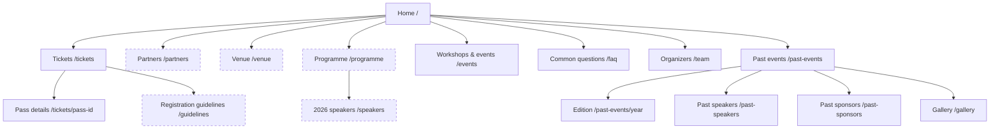

# Public page roadmap — DevFest Indore 2026

22 October 2026 · Guidelines, Partners and Venue implemented locally; remaining proposals are content-dependent.

## Recommendation

Build a shareable **Registration guidelines** page first, followed by **Partners** and **Venue**. Keep the homepage concise, with previews linking to useful detail. Expand **Programme** and introduce **2026 speakers** when confirmed content supports those pages. Keep Get tickets visible throughout.

The [implemented information architecture](information-architecture.md) documents today's site. Admin remains deferred.

Implementation update: the first three additions now exist at `/guidelines`, `/partners` and `/venue` in the local preview. Ticket pages, Explore, the footer and relevant homepage previews link to them. Production deployment and the external KonfHub update are still separate steps. The original proposal and audit below remain as the rationale for future work.

Subsequent organizer direction: temporarily hold partner identities behind a reveal-soon invitation, retain the existing card design behind `pages.partners.revealed`, enlarge the community section, acknowledge the 2014 origin and curate a seven-photo carousel from the supplied albums and existing photos. Implemented locally with a horizontal rocket rail below the header, stronger hero details, compact Programme and a larger venue photo. The supplied albums cover DevFest and Cloud Community Days; captions distinguish them. See `photo-selection-2026-10-22.md`.

Latest ticket direction: one `/tickets` page with inline pass information and a large red Register action to the now-public KonfHub event. Separate pass pages are removed and redirect to the index; no pass detail URLs are published in the sitemap. The website event-page link is enabled independently of local preview dates. KonfHub controls actual ticket availability, pricing and payment.

## Evidence and audience

Compared the rendered [original homepage](https://devfest.indore.community/) and its internal links on 22 October, the earlier repository route snapshot at `8154151`, and the current local routes/content. This is a homepage/link and source audit, not a crawl of every external destination. No attendee interviews or navigation tests were available; labels and priorities follow the organizer's requests and the tasks below.

| Audience | Main tasks |
|---|---|
| Attendees | Choose a pass, prepare KonfHub details, understand entry requirements, arrive at the venue |
| Students | Check eligibility, required ID and workshop access |
| Prospective partners | Understand the event, see confirmed contributions, submit an enquiry |
| Speakers | Find the official CFP and, later, their confirmed session |
| Community visitors | Explore previous editions, workshops, photographs and social posts |

## What is already covered

The original public routes `/team`, `/past-speakers` and `/gallery` remain. `/workshops` redirects to `/events#workshops`, combining workshops and community events. Tickets, pass details, FAQs and edition archives now have their own destinations. The old admin route is intentionally outside this launch work.

Several original navigation items were homepage fragments rather than separate pages: About, Events, Instagram Feed, Sponsors, CFP, Content Pillars, Space Alliance, Schedule, Venue and FAQ. Their missing presentation should be assessed separately from missing routes.

## Proposed additions and order

| Order | Page / URL | Purpose and scope | Readiness |
|---|---|---|---|
| 1 | Registration guidelines `/guidelines` | Booking checklist, LinkedIn reminder, QR and physical ID, pass-specific eligibility, workshop capacity, final-sale rules, corrections, conduct and support | Approved policy copy already exists in canonical JSON |
| 2 | Partners `/partners` | Confirmed 2026 partners and their actual contributions; clear call-for-partners action; previous-edition context through archive links | Existing confirmed records and application link are usable; any pitch/deck must be approved before adding |
| 3 | Venue `/venue` | Venue photo, exact address, map, directions, check-in and arrival preparation | Existing venue facts are usable; parking, transport and accessibility details require confirmation |
| 4 | Programme `/programme` | Topic overview, then confirmed sessions with times, rooms and speakers as available | Keep the existing homepage preview for now; no invented timetable |
| 5 | 2026 speakers `/speakers` | Confirmed current-year speakers, biographies and links to approved sessions | Wait for confirmed 2026 speaker records; keep `/past-speakers` clearly historical |

### First page: Registration guidelines

Use the public label **Registration guidelines**, with stable section links:

1. `#before-booking`: KonfHub profile, LinkedIn URL and accurate attendee details.
2. `#entry`: ticket QR, matching original physical government photo ID and entry checks.
3. `#eligibility`: clearly scoped student and private-code pass rules.
4. `#workshops`: only the selected pass's inclusions; capacity and announced conditions.
5. `#ticket-policy`: cancellation, transfer, resale and refund rules from approved records.
6. `#support`: corrections, organizer contact and the official code of conduct.

Keep a short summary on ticket pages and link to the full guidelines near booking steps. The page, FAQs and exported KonfHub copy must read the same policy records. Preserve the existing `/tickets#attendee-policies` target so shared links still work. Link the new page from the footer and Explore. Add its public URL to KonfHub when that platform's guidance is updated.

## Recover useful original content

| Original content | Proposed treatment |
|---|---|
| Instagram feed / social stream | Add a small homepage section with real post/reel links and approved thumbnails. Link to Instagram; a separate social page is unnecessary initially. Generic profile links cannot stand in for individual posts. |
| About / city story | Strengthen a short homepage introduction and link to team and past editions. Revisit `/about` only if there is substantial distinct content. |
| CFP | Keep the official Sessionize link prominent in Get involved. Add a `/speak` explainer only if confirmed deadlines, requirements and FAQs justify it. |
| Satellite / city events | Use `/events` for confirmed events with real dates and registration links. Do not republish tentative meetups as scheduled events. |
| Space collaboration | Explain verified contributions in the homepage preview and Partners page, without implying a completed agreement. |
| Sponsor deck | Restore a link only after confirming the document is current and approved for public sharing. |
| Photographs / previous editions | Continue the existing gallery and edition pages; add verified photos with accurate captions. |
| Support / contact | Keep a clear organizer contact on Guidelines and FAQ. A separate contact page can wait. |

## Proposed sitemap

Solid nodes below represent current destinations. Dashed nodes represent proposed pages; Programme and Speakers are content-dependent.



## Navigation and journeys

```text
Header: [Brand] [Programme] [Social icons] [Appearance] [Explore] [Get tickets]
Mobile: retain visible Get tickets and the existing compact controls/social row

Explore
  Attend: Tickets · Registration guidelines · Venue · Common questions
  Discover: Programme · Workshops & events · Partners · Organizers
  Archive: Past events · Past speakers · Past sponsors · Photo gallery
  Add 2026 speakers when confirmed profiles are published

Footer: Attend | Get involved | Community | Explore more
```

New pages belong in Explore, the footer and relevant homepage previews; avoid adding every page to the header. Until Programme becomes a full page, its links continue to `/#flow`.

Key journeys:

- First-time attendee: Home → Tickets → prepare profile / check guidelines → KonfHub when booking is enabled.
- Ticket holder: Guidelines → entry checklist → Venue.
- Prospective partner: Home partner preview → Partners → official application form.
- Returning visitor: Home → Past events → edition, speakers or photos.

## Content ownership and implementation rules

Use existing `content/*.json` records and typed selectors. Guidelines draw from `tickets.json` and `event.json`; Partners from `partners.json`; Venue from `event.json`; Programme from `themes.json` and confirmed `sessions.json`; current speakers from confirmed `speakers.json` joined to `people.json`. Add schema-backed fields for newly approved public copy where needed. Planning documents are not application data.

Preserve the existing distinction between current participation and historical appearances. Keep partner contribution labels explicit; a logo does not establish a financial sponsorship tier. Keep pass eligibility scoped to the relevant pass. Maintain existing listing pagination and filters; these additions do not require global site search or a new tag system.

Use lowercase, stable URLs without trailing slashes. Give each published page a clear title, description, canonical URL, social preview and sitemap entry. Keep existing pass IDs and archive URLs stable. Only publish ready pages; proposed routes do not belong in navigation or the sitemap yet.

For old fragment links, retain meaningful anchor aliases or handle them in the page: About → introduction, pillars/schedule → programme preview, collaboration/sponsors → partners preview, CFP → speaker action, FAQ → FAQ destination, social stream → social preview when restored. Hash fragments never reach the server, so HTTP redirects alone cannot repair them. Preserve the `/workshops` redirect and existing ticket-policy target.

## Review before launch

Check that a visitor can find student ID requirements, LinkedIn preparation, venue directions and the partner form from the homepage in at most three clicks. Test those tasks with attendees when available; the proposed labels have not yet been user-tested. Preview mobile and both appearance modes, check keyboard navigation and verify internal/external links. Run content validation and TypeScript checks for implementation changes.

Open content dependencies: approved partner pitch/deck; venue parking and accessibility information; exact social post URLs and assets; confirmed 2026 speakers and sessions. These do not block planning or the Guidelines page. Admin and broader policy-page work remain outside this increment.

## Follow-up: direct original-branch audit

Inspected local `main` (`b22aac5`), `origin/develop` (`61792ff`) and the later original `codex/event-copy-design` (`8eb9eaa`) without switching branches. Current launch work was committed first as `e92f1df` at the organizer's request. These are local ref snapshots; no remote fetch was performed.

The earlier `main` and `origin/develop` have only the homepage as an application page. The later original has `/`, `/gallery`, `/past-speakers`, `/team`, `/workshops` and `/admin`. Every public page from that later original is retained or redirected in the current site; admin is deliberately deferred. The route audit therefore found no additional lost public page beyond the new detail-page opportunities proposed above.

Source files checked include the original `src/app/page.tsx`, the section resolver and default configuration in `src/lib/firestoreService.ts`, and the component files listed below. The old configuration could be overridden by Firestore, so source defaults alone do not prove live visibility; the earlier live homepage audit provides that separate evidence.

| Missing or reduced presentation | Original source | Current treatment / recommendation |
|---|---|---|
| About DevFest and the Indore story | `AboutSection.tsx` | Homepage hero is shorter. Add a concise introduction; a separate About page remains optional. |
| Instagram feed | `InstagramFeedSection.tsx` | Original used an Elfsight app, not just social links. Add a curated visual strip or assess that existing embed; post thumbnails and reels need actual links/assets. |
| CFP showcase | `CallForSpeakersSection.tsx` | Sessionize link remains in Programme and footer. Restore a stronger visual invitation; a `/speak` page depends on approved requirements/deadlines. |
| Organizer preview and alumni strip | `FeaturedTeamSection.tsx` | Full team and past-speaker directories remain. A compact homepage preview could improve discovery. |
| Satellite meetups | `SatelliteEventsSection.tsx` | `/events` exists. Publish confirmed current events there rather than making another directory or restoring unverified scheduling claims. |
| Space collaboration narrative | `SpaceCollaborationSection.tsx` | Partner preview remains. Expand verified contribution copy on the proposed Partners page. |
| Recap / milestones | `EventRecapSection.tsx` | Archives cover previous editions. Put verified edition outcomes there; a 2026 recap belongs after the event. |
| Five content pillars and collective-flow narrative | `ContentPillarsSection.tsx`, `ThreeDFlowSection.tsx` | Current Programme consolidates the topic presentation. Preserve useful approved subject copy without reinstating redundant sections. |

### Additional ideas found in dormant source

The later original also contains dormant components with no references from other source files. Their existence is not evidence that they were reachable on the live homepage. Related features are distinguished below:

- **Indore visitor guide:** `IndoreExperienceSection.tsx`. The older `main` did import/render it. This could become an optional `/visit-indore` page, or a short section on Venue, covering travel and local recommendations. Old promises of a hosted food walk, specific breakfast and sustainability arrangements require fresh confirmation.
- **Venue zones / experience:** `ShowcaseZonesSection.tsx` and `VENUE_ZONES` in `src/data/ecosystemData.ts`. Nine proposed areas included a main hall, two workshop tracks, Qualcomm showcase, enterprise showcase, space corner, experts' lounge, community lounge and registration arena. Use the proposed Venue page for a real approved floor plan; the source array does not confirm these facilities.
- **Session overview and saved agenda:** `SplitSessionsSection.tsx` and `ScheduleSection.tsx` are dormant in the later branch. Its homepage still renders `SavedSessionsModal.tsx`, but saved-session state starts with preset IDs. A future Programme page can offer local bookmarks once actual confirmed sessions exist; this is not an existing dependable schedule to restore.
- **Solar-system visualization:** `SolarSystemEcosystem3D.tsx`. A dormant visual feature rather than another missing page; revisit only if it makes programme discovery easier.

Recommended adjustment to the build order: keep Guidelines → Partners → Venue. Fold confirmed venue-experience details into Venue; treat an Indore visitor guide as optional. Recover Instagram and a clearer CFP invitation as small homepage improvements. Programme, current speakers and saved-session functionality remain dependent on confirmed programme content.
